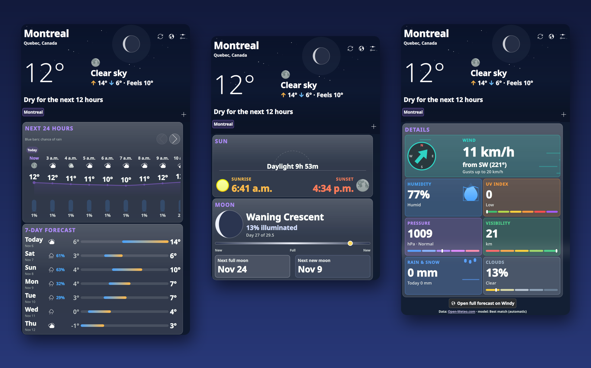
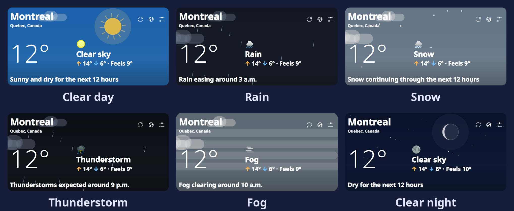
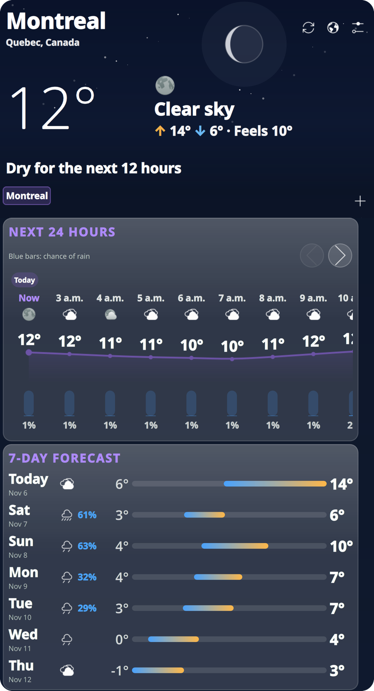
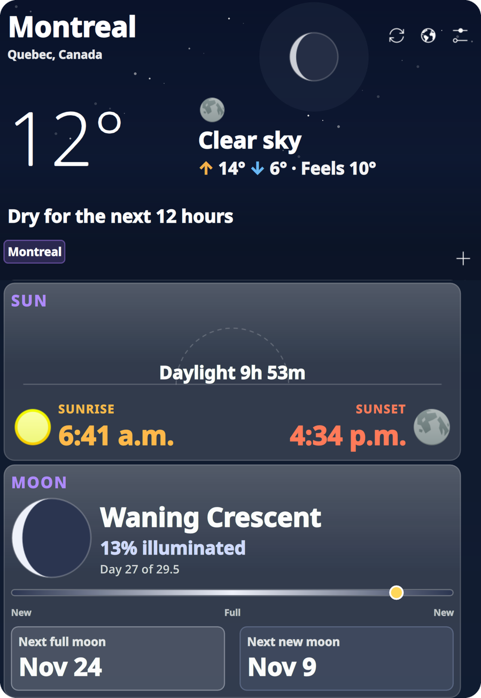
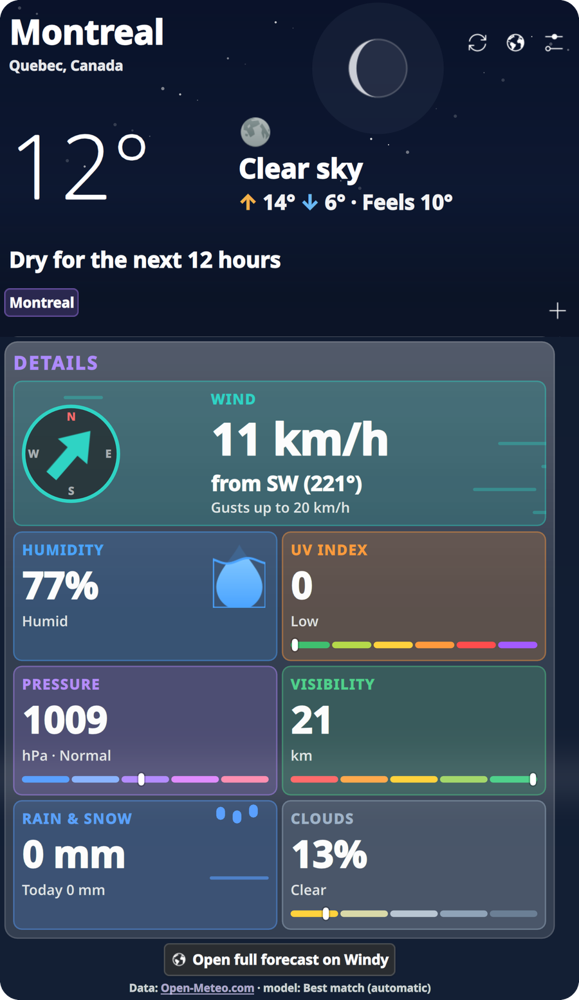
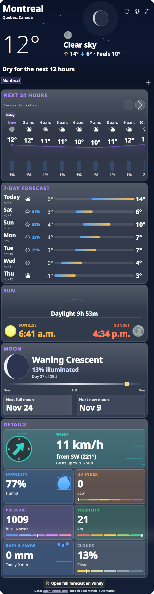
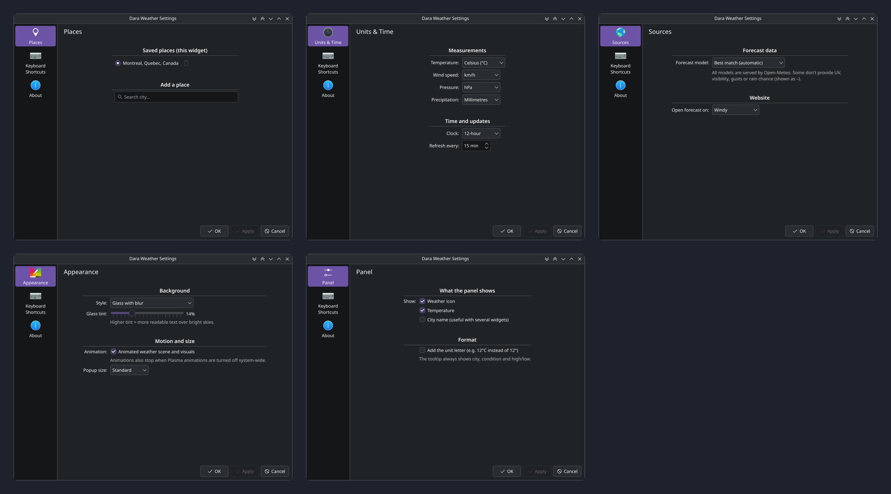

<div align="center">

# DaraPlasmoids

**Custom widgets for KDE Plasma 6**

[](https://kde.org/plasma-desktop/)
[](https://doc.qt.io/qt-6/qtqml-index.html)
[](LICENSE)
[](https://open-meteo.com)

</div>

## Dara Launcher

A fast, full-screen application launcher (in [`launcher/`](launcher)): favorites, all apps as a grid, a list or A–Z sections, categories, recent and most-used apps, search across apps, files, settings and the calculator, and power buttons. Press **Meta** and it opens at once, full screen on your **primary monitor**, whichever monitor has focus.

```sh
kpackagetool6 -t Plasma/Applet -u launcher || kpackagetool6 -t Plasma/Applet -i launcher
launcher/tests/run.sh      # sandboxed UI suite: your real widget and settings are untouched
```

Screenshots, the full feature list and settings reference: [DaraSamii/DaraLauncher](https://github.com/DaraSamii/DaraLauncher).

## Dara Weather

A detailed, animated, glass-styled weather widget for your Plasma panel. Click it and a popup slides out with the current conditions, an hourly strip, a multi-day forecast, sun and moon, and rich detail cards. Add one widget per city (for example **Montreal** and **Tehran**) — every instance keeps its own places and settings.

<div align="center">
  
</div>

### Contents

- [Features](#features)
- [Screenshots](#screenshots)
- [Install](#install)
- [Using it](#using-it)
- [Settings reference](#settings-reference)
- [Data sources](#data-sources)
- [How it works](#how-it-works)
- [Development](#development)
- [Troubleshooting](#troubleshooting)
- [Privacy](#privacy)
- [Known limits](#known-limits)
- [Credits and license](#credits-and-license)

---

## Features

**Look and feel**
- **Glass design** — the animated sky fills the popup, is blurred behind the content, and every section is a frosted card with a bright top edge. A dark scrim under the glass keeps text readable on bright skies. Choose *Glass with blur*, *Glass*, or a plain Plasma-theme background.
- **Animated scenes** that follow the weather and time of day: sun with rotating rays, moon with real phase, twinkling stars, drifting clouds, rain, snow, fog and lightning.
- Smooth reveal animations: temperature counts up, the hourly curve draws itself, range bars grow, cards slide in one after another.
- Animations switch off automatically when Plasma animations are disabled system-wide.

**Information**
- **Panel widget**: weather icon + temperature, optional city name and unit letter; tooltip with condition and ↑ high / ↓ low.
- **Plain-language summary** under the temperature: "Rain expected around 3 p.m.", "Dry for the next 12 hours", or how much wind/humidity changes the feel.
- **Hourly strip** (12 / 24 / 48 hours): icon, temperature curve, and a **rain-chance bar with the percentage for every hour**. Day markers show where one day ends and the next begins (`Today`, `Sat · Nov 7`). Slide with the ‹ › buttons, by dragging, with a touchpad, or Shift + wheel.
- **Daily forecast** (3–7 days): weekday and date (`Sat` / `Nov 7`), rain chance, and animated low → high range bars.
- **Sun**: bold sunrise and sunset times, daylight length, and a pulsing sun showing where it is on its arc.
- **Moon**: the real phase in the night sky, plus a card with the phase name, illumination %, day of the lunar cycle, a new → full → new progress bar, and the next full and new moon (mirrored for the southern hemisphere).
- **Detail cards** with their own visuals: a wind compass with a swinging arrow and streaks that blow faster in stronger wind, a water droplet that fills to the humidity level, falling drops for rain and snow (amount so far today, and over the last 24 hours), and colored gauges for UV index, pressure, visibility and cloud cover.

**Practical**
- **Multiple places** per widget: switch with chips, add with **+** (city search), remove with the trash button on the selected chip.
- **Choose your source**: forecast model (GEM – Environment Canada, ECMWF, GFS, ICON, Météo-France, JMA, or best match) and the website the globe button opens (Windy, Yr, Open-Meteo, Google Weather).
- **Offline-friendly**: if a refresh fails you keep the last data with an "Offline — showing data from …" notice.
- **Six grouped settings pages** — Places, Units & Time, Sources, Appearance, Panel, Content — including per-card visibility and 12/24-hour clock (`2 a.m.` / `3 p.m.`).

## Screenshots

**Weather scenes** — the background follows the conditions and the time of day:

<div align="center">
  
</div>

**Forecast: hourly strip with rain chance, day markers and the 7-day list**

<div align="center">
  
</div>

**Sun, moon and detail cards**

<div align="center">
  
  
</div>

**The whole popup, top to bottom**

<div align="center">
  
</div>

**Settings**

<div align="center">
  
</div>

---

## Install

**Requirements:** KDE Plasma 6 (developed on 6.7), Qt 6, and internet access. No API key.

### From this repository

```sh
git clone https://github.com/DaraSamii/DaraPlasmoids.git
cd DaraPlasmoids
./install.sh
```

`install.sh` runs `kpackagetool6 -t Plasma/Applet -u weather` (and falls back to `-i` on a fresh install). Afterwards: right-click the panel → **Add Widgets…** → search **Dara Weather** and drag it in.

If it does not show up or an old version keeps running, restart the shell:

```sh
kquitapp6 plasmashell && kstart plasmashell
```

### As a `.plasmoid` file

```sh
cd weather && zip -r ../dara-weather.plasmoid . && cd ..
kpackagetool6 -t Plasma/Applet -i dara-weather.plasmoid
```

### Try it without touching a panel

```sh
plasmawindowed io.github.darasamii.weather
```

### Uninstall

```sh
kpackagetool6 -t Plasma/Applet -r io.github.darasamii.weather
```

---

## Using it

| You want to… | Do this |
|---|---|
| Open the forecast | Click the widget in the panel |
| Switch city | Click a city chip under the header |
| Add a city | Click **+**, type at least two letters, pick a result |
| Remove a city | Select it, then click the trash icon next to its chip (the last city cannot be removed) |
| Refresh now | Click the refresh icon in the header |
| Open a weather website | Click the globe icon (or **Open full forecast** at the bottom) |
| See later hours | ‹ › buttons above the hourly strip, drag, swipe, or Shift + wheel |
| Open settings | Gear icon in the header, or right-click the widget → *Configure* |

### One widget per city

1. Add the widget to a panel and open its settings → **Places**.
2. Add your city (e.g. *Montreal*) and select it.
3. Add a second widget (another panel or the same one) and select *Tehran*.

Each widget stores its own list and selection. Turn on **Panel → City name** so you can tell them apart at a glance.

---

## Settings reference

| Page | Setting | Options |
|---|---|---|
| **Places** | Saved places, current place, search | any city from the geocoder |
| **Units & Time** | Temperature | °C, °F |
| | Wind speed | km/h, mph, m/s, knots |
| | Pressure | hPa, inHg, mmHg |
| | Rain & snow amount | mm, inches |
| | Clock | 12-hour (`2 a.m.`) or 24-hour (`02`) |
| | Refresh interval | 5–180 minutes (default 15) |
| **Sources** | Forecast model | Best match, GEM, ECMWF IFS, GFS, ICON, Météo-France, JMA |
| | Website | Windy, Yr, Open-Meteo, Google Weather |
| **Appearance** | Background style | Glass with blur, Glass (no blur), Plain (Plasma theme) |
| | Glass tint | 4–40 % (higher = more readable over bright skies) |
| | Animations | on / off |
| | Popup size | Compact, Standard, Large |
| **Panel** | Show | weather icon, temperature, city name |
| | Format | add the unit letter (`12°C` instead of `12°`) |
| **Content** | Overview | plain-language summary |
| | Forecasts | hourly (12 / 24 / 48 h), daily (3–7 days), sun, moon |
| | Detail cards | wind, humidity, UV, pressure, visibility, rain & snow, clouds |

---

## Data sources

Forecasts and city search come from [Open-Meteo](https://open-meteo.com), which blends national weather-service models behind one free API. The **Forecast model** setting picks which model is used:

| Model | Provider | Notes |
|---|---|---|
| Best match | Open-Meteo | Chooses automatically for your location (default) |
| GEM | Environment and Climate Change Canada | Good choice for Canadian cities |
| ECMWF IFS | European Centre for Medium-Range Weather Forecasts | |
| GFS | NOAA (USA) | |
| ICON | DWD (Germany) | |
| Météo-France | Météo-France | |
| JMA | Japan Meteorological Agency | |

Some models do not provide every variable (UV index, visibility, wind gusts, rain chance). Missing values are shown as `–` instead of a misleading zero.

All times are shown in the city's local time (Open-Meteo returns location-local timestamps, which the widget displays without converting). The moon phase is computed locally from the date, so it needs no data source.

---

## How it works

```
weather/                        the Plasma applet package
├── metadata.json               id: io.github.darasamii.weather
└── contents/
    ├── config/
    │   ├── main.xml            settings schema (all keys + defaults)
    │   └── config.qml          the six settings categories
    ├── code/
    │   └── weather.js          WMO weather codes, icon mapping, Open-Meteo URL builder,
    │                           response normalizer, summary sentence, moon-phase maths,
    │                           place list helpers, formatting
    └── ui/
        ├── main.qml            PlasmoidItem: fetch + refresh timer + shared state
        ├── CompactRepresentation.qml   the panel icon/temperature
        ├── FullRepresentation.qml      the popup (glass layers, hero, cards)
        ├── WeatherScene.qml    animated sky (sun/moon, stars, clouds, rain, snow, fog, lightning)
        ├── MoonDisc.qml        moon drawn at any phase
        ├── Card.qml            glass card with staggered entrance
        ├── HourlyChart.qml     scrollable hourly strip: curve, icons, rain bars, day markers
        ├── DayRow.qml          one row of the daily forecast
        ├── SunArc.qml          sunrise/sunset arc
        ├── WindCard.qml        compass + wind streaks
        ├── Tile.qml, DropFill.qml, RainDrops.qml   detail tiles and their visuals
        ├── PlaceSearch.qml     city search (Open-Meteo geocoding)
        └── config*.qml         the six settings pages
```

**Data flow.** `main.qml` builds one request from the selected place and your unit/model settings, fetches it with `XMLHttpRequest`, and normalizes the JSON in `weather.js` (current conditions, the next N hours, the daily list). Every view reads that single `wx` object. Changing the place, units, model or hour count discards the old data and refetches; a stale-response guard drops late replies for a previous place. A timer refreshes on your chosen interval.

**Glass.** `WeatherScene` fills the whole popup. Below the hero, a `MultiEffect` blurs a live copy of it, masked with a gradient so the hero stays sharp. Cards are translucent white with a border and a top sheen, over a dark contrast scrim.

**Packaging.** It is a plain Plasma applet (`Plasma/Applet` KPackage); there is no compiled code.

---

## Development

```sh
# edit files in weather/, then reinstall and run in a window
kpackagetool6 -t Plasma/Applet -u weather
plasmawindowed io.github.darasamii.weather
```

- QML errors print to the terminal that launched `plasmawindowed`. For the real shell: `journalctl --user -b | grep -i darasamii`.
- `weather.js` is a `.pragma library`, so it has no access to `i18n`; condition names are English.
- To inspect the settings dialog from a window, trigger `Plasmoid.internalAction("configure")`.
- Adding a setting means: an `<entry>` in `config/main.xml`, a `cfg_<name>` (and `cfg_<name>Default`) property plus a control on the relevant `config*.qml` page, and reading it through `Plasmoid.configuration.<name>`.

---

## Testing

Three layers, all runnable locally:

```sh
node tests/weather.test.js        # 41 offline unit tests for the logic in weather.js
node tests/live.test.js           # live checks: all 7 forecast models x 7 cities worldwide,
                                  #   every unit combination, and city search (Latin, Persian,
                                  #   Cyrillic, Chinese, accented names)
python3 tests/qml_matrix.py       # runs the real widget under 35 setting combinations
```

- **Unit tests** cover weather codes and icons, 12/24-hour labels (`12 a.m.`, `12 p.m.`), place list handling (de-duplication, the last place can't be removed, corrupt config), URL building for every unit/model combination, response normalisation (missing data stays `null`, short-horizon models are cut cleanly), the summary sentence, and the moon-phase maths against known new and full moons.
- **Live tests** call Open-Meteo for each forecast model in cities across both hemispheres and the date line and check that every response normalises into sane values.
- **QML matrix** installs throw-away copies of the widget under a test id (your real install is never touched), runs each in `plasmawindowed`, fails a variant if QML prints any error or warning, and saves a picture of what the widget rendered. Variants include metric/imperial and every wind and pressure unit, 12/48 hours, all three background styles, tint extremes, every popup size, animations off, every card hidden, each forecast model, southern-hemisphere and many-city setups, corrupt or empty place lists, every panel layout, and the no-network error state.

## Troubleshooting

| Problem | Fix |
|---|---|
| Clicking the widget does nothing, or an old version runs | Restart the shell: `kquitapp6 plasmashell && kstart plasmashell` |
| "Could not load weather" | No network, or Open-Meteo is unreachable. Press refresh; the widget retries on its timer |
| UV, visibility, gusts or rain chance show `–` | The selected forecast model does not provide them — switch to *Best match* |
| Text is hard to read over a bright sky | Appearance → raise **Glass tint**, or choose **Plain** |
| The popup feels heavy on a weak GPU | Appearance → **Glass (no blur)**, or turn **Animations** off |
| City not found | Try the English name, or add the country (e.g. `Springfield`, then pick the right result) |
| Hours show `02` instead of `2 a.m.` | Units & Time → Clock → 12-hour |

---

## Privacy

The widget talks only to `api.open-meteo.com` and `geocoding-api.open-meteo.com`. It sends the latitude/longitude of the cities **you** added and your city search text — never your own location, account, or any identifier. The place list is stored in your Plasma configuration on your machine. Websites open only when you click the globe or the "Open full forecast" button.

## Known limits

- Condition names are English only (other UI strings use `i18n`, but no translations ship yet).
- Data is kept in memory only; with no network at startup the popup shows an error until the next refresh.
- The moon phase and next full/new moon are computed with a standard approximation, accurate to roughly a day.
- Every forecast comes through Open-Meteo; other providers (e.g. a dedicated Environment Canada API) are not supported.
- Tested on Plasma 6.7 only.

## Credits and license

- Weather and geocoding data: [Open-Meteo.com](https://open-meteo.com) ([CC BY 4.0](https://creativecommons.org/licenses/by/4.0/); free API for non-commercial use).
- Weather icons: [Breeze](https://invent.kde.org/frameworks/breeze-icons) icon theme from your Plasma installation.
- Built with Qt 6 / QML and Kirigami.

Released under the [GNU General Public License v3.0](LICENSE) © 2026 Dara Samii.

[**Dara Launcher**](#dara-launcher) (in `launcher/`, also on [GitHub](https://github.com/DaraSamii/DaraLauncher)) is released under the same license.
