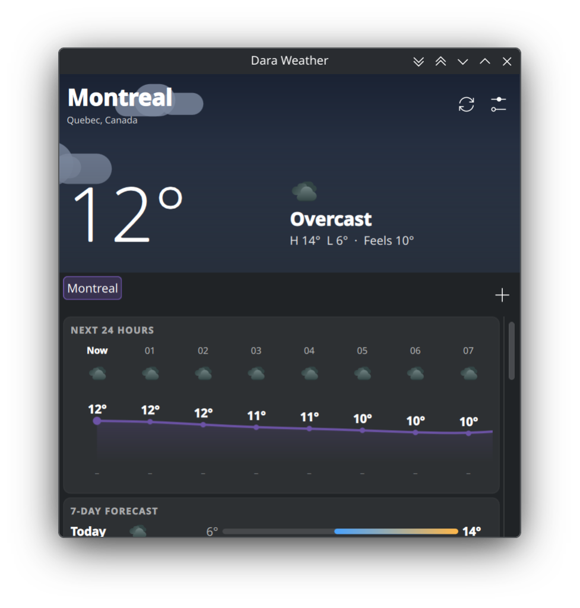

# DaraPlasmoids

Custom widgets for **KDE Plasma 6**.

## Dara Weather

A detailed, animated weather widget for your panel. Add one per city (e.g. Montreal and Tehran) — each instance keeps its own place list and settings.



### Features

- **Panel icon + temperature**, with the city name optionally shown (handy with several widgets). Tooltip shows condition and high/low.
- **Animated hero scene** that follows the weather and time of day: sun with rotating rays, moon and twinkling stars, drifting clouds, rain, snow, fog and lightning.
- **Next 24 hours**: scrollable strip with icons, a smooth temperature curve that draws itself in, and precipitation chance (Shift + wheel or drag to scroll sideways).
- **7-day forecast** with animated high/low range bars.
- **Sun arc**: sunrise, sunset, daylight length and the sun's current position.
- **Details**: wind (with direction arrow and gusts), humidity, UV index, pressure, visibility, precipitation, cloud cover.
- **Multiple places**: switch with chips in the popup, add with the **+** button (city search), manage in settings.
- Metric / imperial, 12 / 24-hour clock, refresh interval, animations on/off.
- Uses your Plasma theme (colors, icons, fonts) and works in light and dark themes.

### Install

Requires Plasma 6 (tested on 6.7) and internet access.

```sh
git clone https://github.com/DaraSamii/DaraPlasmoids.git
cd DaraPlasmoids
./install.sh          # kpackagetool6 install/upgrade for your user
```

Then right-click the panel → **Add Widgets…** → search **Dara Weather**. If it doesn't appear, run `kquitapp6 plasmashell; kstart plasmashell`.

Try it without adding to a panel: `plasmawindowed io.github.darasamii.weather`.

Uninstall: `kpackagetool6 -t Plasma/Applet -r io.github.darasamii.weather`.

### One widget per city

1. Add the widget to a panel and open its settings (right-click → *Configure*, or the gear in the popup).
2. Search and add your city (e.g. *Montreal*), select it as the current place.
3. Add a second widget (to another panel or the same one) and select *Tehran*.

Each widget stores its own list and selection, so they never interfere.

### Data

Forecast and geocoding come from [Open-Meteo](https://open-meteo.com) — free, no API key. Open-Meteo's free tier is for non-commercial use. Times are shown in the city's local time.

### Layout

```
weather/
  metadata.json
  contents/
    config/      main.xml (settings schema), config.qml
    code/        weather.js (WMO codes, formatting, Open-Meteo requests)
    ui/          main.qml, Compact/FullRepresentation, WeatherScene,
                 HourlyChart, DayRow, SunArc, Tile, Card, PlaceSearch, configGeneral
```

### Known limits

- Condition names are English only (UI strings are translatable via `i18n`, no translations shipped yet).
- Data is kept in memory only; with no network at startup the popup shows an error until the next refresh.
- Hourly chart shows 24 h; daily shows 7 days.

### License

MIT — see [LICENSE](LICENSE).
